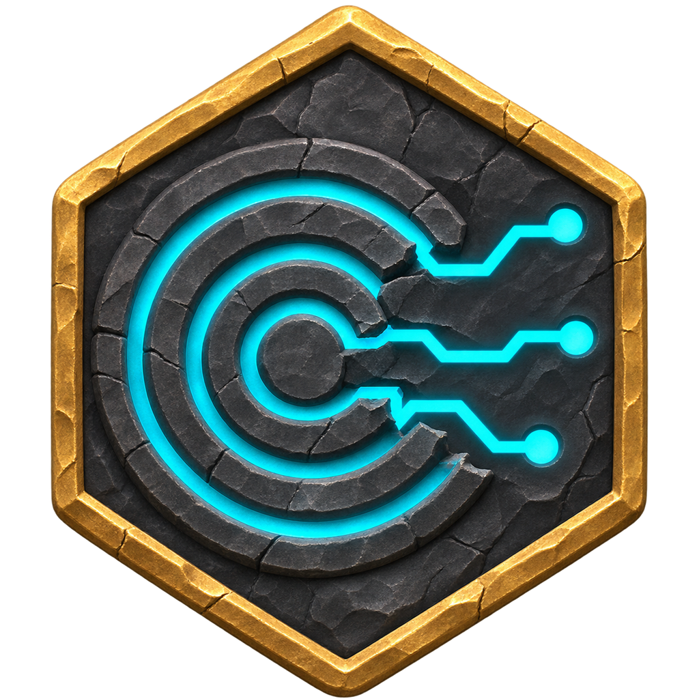
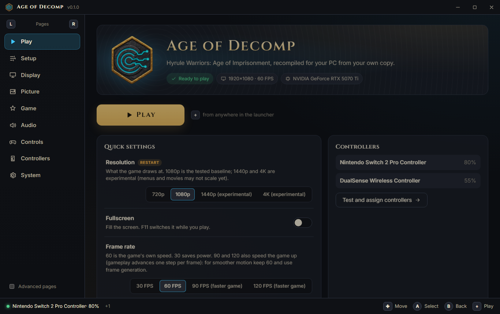
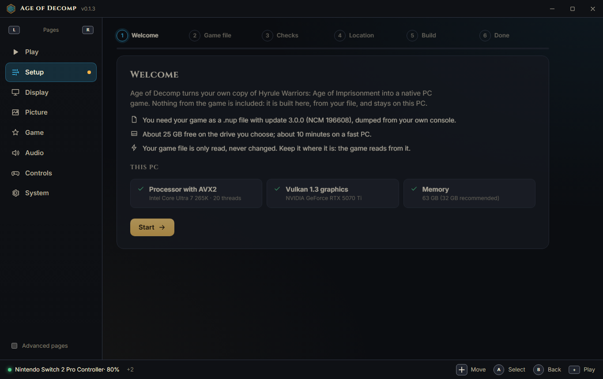
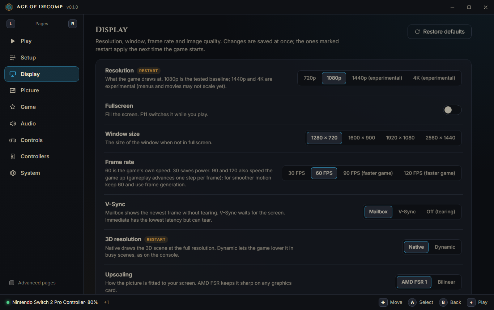
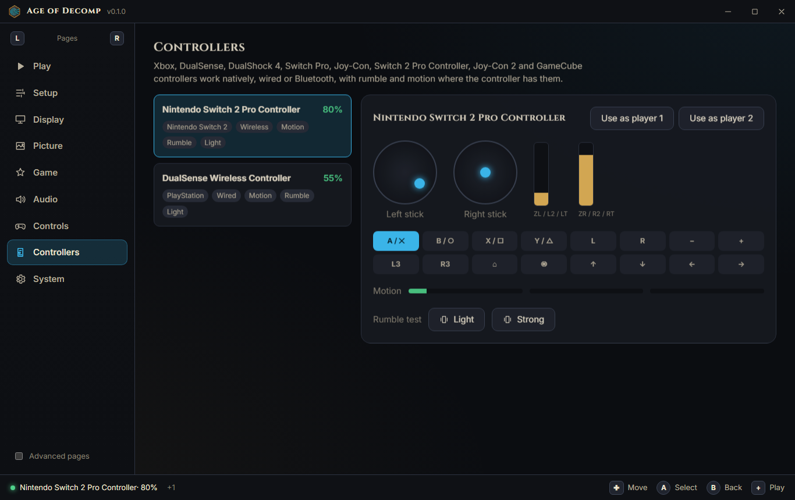

<p align="center">
  
</p>

<h1 align="center">Age of Decomp</h1>

<div align="center">
<table>
  <tr>
    <td rowspan="2"><a href="https://recompstore.com/dev/icosisenpai"></a></td>
    <td><a href="https://decompbuddy.com/games/hyrule-warriors-age-of-imprisonment-age-of-decomp-nintendo-switch-2"></a></td>
  </tr>
  <tr>
    <td><a href="https://decompbuddy.com/games/hyrule-warriors-age-of-imprisonment-age-of-decomp-nintendo-switch-2?install"></a></td>
  </tr>
</table>
</div>

<p align="center">
  <b>Hyrule Warriors: Age of Imprisonment</b>, recompiled into a native Windows and Linux game from <b>your own</b> copy.<br>
  Easy step-by-step setup · complete graphics settings · native Xbox, PlayStation, Switch and Switch 2 controllers ·
  <a href="https://github.com/elripalda/RecompLauncher">RecompLauncher</a> ready
</p>

<p align="center">
  
  <a href="LICENSE"></a>
  
  
</p>

<h1 align="center">🧪 Testers wanted: handheld PCs and Linux</h1>

<p align="center">
  Do you play on a <b>Steam Deck, ROG Ally, Legion Go, MSI Claw</b> or another handheld, or on a <b>Linux</b> PC?<br>
  I am looking for you. Build the game, play for a while, then
  <a href="https://github.com/iCosiSenpai/age-of-decomp/issues/new/choose"><b>open an issue</b></a> with your device,
  what worked, what did not, and the newest <code>game-*.log</code>.<br>
  Windows handhelds use the Windows release; Linux, SteamOS and Bazzite use the Linux AppImage, best through
  RecompLauncher on a Steam Deck.
</p>

> [!NOTE]
> **What I cannot test myself.** I have no Linux PC, no SteamOS device, no AMD Radeon graphics card and no
> PlayStation controller, so I cannot see whether Age of Decomp really works with them. For those I count on your
> tests and your logs to find and fix problems: please report what you see, with the newest `game-*.log`.

> [!IMPORTANT]
> **Bring your own game.** Age of Decomp contains nothing from Nintendo or Koei Tecmo and never downloads game files,
> keys or firmware. You need your own dump of the game as a **`.nup` file with the base game and update 1.0.3
> (NCM 196608)**. The game is built **on your PC**; the result is for your own use and must not be shared.

> [!TIP]
> **Help make it better.** Age of Decomp is early, and two things help most:
> - **Share anonymous diagnostics** when the launcher asks at its first start (or in *System → Anonymous
>   diagnostics*). It sends only counts: the version, the system family, the kind of crash or build failure and the
>   frame rate rounded to 5. They go only to the developer, to find what to fix. Your logs, files, names and addresses
>   stay on your PC ([what is sent](docs/DIAGNOSTICS.md)).
> - **Send the log with your report.** On RecompLauncher, leave the log attached when you write a report. On GitHub,
>   attach the newest `game-*.log` from the game folder's `logs`.

## What it is

The game's ARM64 code is translated to C ahead of time and compiled for your processor, with a runtime that provides
the Switch 2's system services and draws through Vulkan (NVN 2 → Vulkan, Ampere shaders → SPIR-V). The engine
started as [HWAoI Recomp](https://github.com/Alano6678/hwaoi-recomp) (built on
[DKB Recomp](https://github.com/Lucas-blip-png/dkb-pc-recomp)) and is developed in this repository since 0.2.0
([`engine/source`](engine/source), origin and authors in [`engine/ORIGIN.md`](engine/ORIGIN.md)). Around it Age of
Decomp has the launcher, the setup, the settings, native controller support, packaging for Windows and Linux, and
RecompLauncher integration.

| | |
|---|---|
| 🧭 **Guided setup** | Pick your `.nup` (it is also found automatically), see every check pass, choose a folder, press *Build*: one progress bar, a list of stages, time left. Stop any time; continuing reuses everything already done. About **7 minutes** on a Core Ultra 7 265K. |
| 🖥️ **Every setting** | Game resolution (automatic, or 720p–4K), window, screen sync, frame rate, 3D resolution, upscaling with AMD FSR or NVIDIA DLSS, NVIDIA frame generation, edge smoothing, sharpness, picture shape, colour (profiles or brightness/contrast/saturation/gamma), performance overlay, graphics card, language, console mode, volume (up to 300 %), mute in the background, audio buffer, players, controller type, button layout, the buttons the game shows, dead zone, motion, rumble strength/curve/triggers, mouse, and the engine's performance and memory options. |
| 🎮 **Controllers, natively** | SDL 3 supports Xbox, DualSense / DualSense Edge, DualShock 4, Switch Pro, Joy-Con and GameCube controllers. Switch 2 Pro and Joy-Con 2 work over USB with our SDL build. On Windows, the Switch 2 Pro Controller can also connect over Bluetooth through the included transport. The launcher and the in-game settings menu show each controller's own buttons, and the game's own button pictures follow the controller you use, your bindings and the keyboard. |
| 🚀 **RecompLauncher ready** | Each release carries `recomplauncher.json`: one-click setup from your `.nup` (the setup checks that it is the supported copy), the settings on the game's page, Big Picture mode, save backups. |
| 🌐 **English, Italian and Simplified Chinese** | Follows your system; switch any time. |

## Screenshots

<table>
  <tr>
    <td></td>
    <td></td>
  </tr>
  <tr>
    <td></td>
    <td></td>
  </tr>
</table>

<sub>The launcher with sample data (`?lang=en` demo mode): no game footage.</sub>

## Status

Early. The game builds, boots, plays its opening and reaches exploration and combat at 60 FPS on tested PCs. Known
limits: a full playthrough is not verified yet. The game itself runs at 30 or 60 FPS, because above 60 the whole game
runs faster; on GeForce RTX 40 and 50 cards NVIDIA frame generation shows more frames than that. Menus and movies
fill the picture at 1440p and 4K; 4K needs a graphics card with 16 GB of video memory (it started and played its
opening here on one).

AMD Radeon: on RX 7000 and RX 9000 cards the game can end with code 70 when the graphics card stops answering
("device lost", [HWAoI Recomp issue #21](https://github.com/Alano6678/hwaoi-recomp/issues/21)). Since 0.2.0 the game
no longer hands its drawing commands to AMD's own driver from a thread of their own, which caused part of these
stops, and *Diagnostics → Draw call markers* makes the log name what the card was working on. None of it could be tried on a Radeon here: a report with
its log helps a lot. On Intel GPUs the first start could stop after two seconds; 0.1.2 fixes it (tested on an Intel
Xe iGPU).

Linux: the AppImage builds the game from your `.nup` with nothing installed (tested in a bare Ubuntu 22.04 container)
and plays it (tested under WSL with a software renderer); speed on real Linux PCs and on the Steam Deck is not tested
yet: a report helps.

## Requirements

Windows 10/11 x64 or Linux x86-64, a CPU with **AVX2**, a **Vulkan 1.3** GPU with `VK_EXT_external_memory_host`
(recent NVIDIA, AMD, Intel drivers), 16 GB RAM (32 GB recommended), about **25 GB** free for the build.
On Linux: glibc 2.34 or newer (SteamOS 3, Ubuntu 22.04, Debian 12, Fedora 36 or newer); kernel 6.7 or later is
faster. Nothing to install to build the game: the compiler is inside the AppImage. Only the launcher's own window needs
WebKitGTK 4.1 from the system; RecompLauncher needs no window from us.

## Quick start

1. Download `AgeOfDecomp-v<version>-Windows-x64.zip` from [Releases](../../releases) and unpack it anywhere.
2. Run **AgeOfDecomp.exe** and follow *Setup*. Keep your `.nup` where it is: the game reads its resources from it.
3. Press **Play**. In game: **Esc** settings, **F10** performance overlay, **F11** fullscreen.

On Linux: download `AgeOfDecomp-v<version>-Linux-x64.AppImage`, make it executable (`chmod +x`) and run it; the same
steps follow. A `.tar.xz` of the same folder is there for a PC that does not run AppImages: unpack it and start
`AppRun`.

With **RecompLauncher**: import the extracted folder through **Settings → Developers → Add a build**.
Drop in your `.nup`, follow Setup, then press Play. The repository can be added through **Add a recomp**;
catalog distribution of this prerelease needs the RecompLauncher team to enable its beta.
See [RecompLauncher integration](docs/RECOMPLAUNCHER.md).

## Updating

The compiler checks GitHub releases at startup. **System → Compiler updates** also has **Check for updates** and,
when a newer Windows package is available, **Update and restart**. The updater verifies the GitHub asset's SHA-256,
stages the package beside the installation, then replaces release-owned files after the compiler exits. It keeps
an installation backup in `.aod-update-*/backup`; the game folder, settings and saves are preserved. Close the game
and finish or cancel Setup before updating. The compiler asks you to rebuild only when an update changes the
game build requirements. Setup reuses your existing build folder, settings, and saves.

Diagnostics are optional and off until you opt in. See [what is collected](docs/DIAGNOSTICS.md).

This repository and its release downloads are public. Update checks and downloads work without a GitHub account.
An existing GitHub CLI login or `GH_TOKEN`/`GITHUB_TOKEN` can also be used. Credentials are never included in the
release or saved in launcher settings. Linux automatic installation is not available yet.

## Building from source

```powershell
py tools/engine.py toolchain     # pinned toolchain into .cache/ (llvm-mingw, SDL 3, Python, …)
py tools/engine.py translator    # shader translator (.NET 10 SDK), from engine/source
py tools/engine.py stage         # portable engine bundle → out/engine/windows
cd apps/launcher; pnpm install; pnpm tauri build --no-bundle
py tools/release.py windows --zip
```

Linux (the same steps with `python3`; `toolchain` fetches LLVM and the Steam Runtime 3 SDK and builds SDL in the SDK's
own image, so it needs docker or podman, make and tar; the translator needs the .NET 10 SDK):

```bash
python3 tools/engine.py toolchain
python3 tools/engine.py translator && python3 tools/engine.py stage    # → out/engine/linux
(cd apps/launcher && pnpm install && pnpm build)
docker run --rm -v "$PWD:/src" -w /src ubuntu:22.04 sh packaging/linux/build-launcher.sh   # the two programs
python3 tools/release.py linux --appimage --bin-dir apps/launcher/src-tauri/target/release
```

Details: [AGENTS.md](AGENTS.md) (also the rules for AI agents working on this repository).

## Credits and licence

GPL-3.0-or-later. The engine comes from HWAoI Recomp (Alano6678, LibertyPrime27, ripps818, fgabe, PrimeWalkerVN and
contributors) and, before it, DKB Recomp; it also uses Ryujinx, Eglantine, SDL and more:
[THIRD_PARTY_NOTICES.md](THIRD_PARTY_NOTICES.md), [engine/ORIGIN.md](engine/ORIGIN.md).

Age of Decomp is an independent, non-commercial fan project, not affiliated with or endorsed by Nintendo or
Koei Tecmo. *Hyrule Warriors*, *The Legend of Zelda* and *Nintendo Switch 2* are trademarks of Nintendo.
